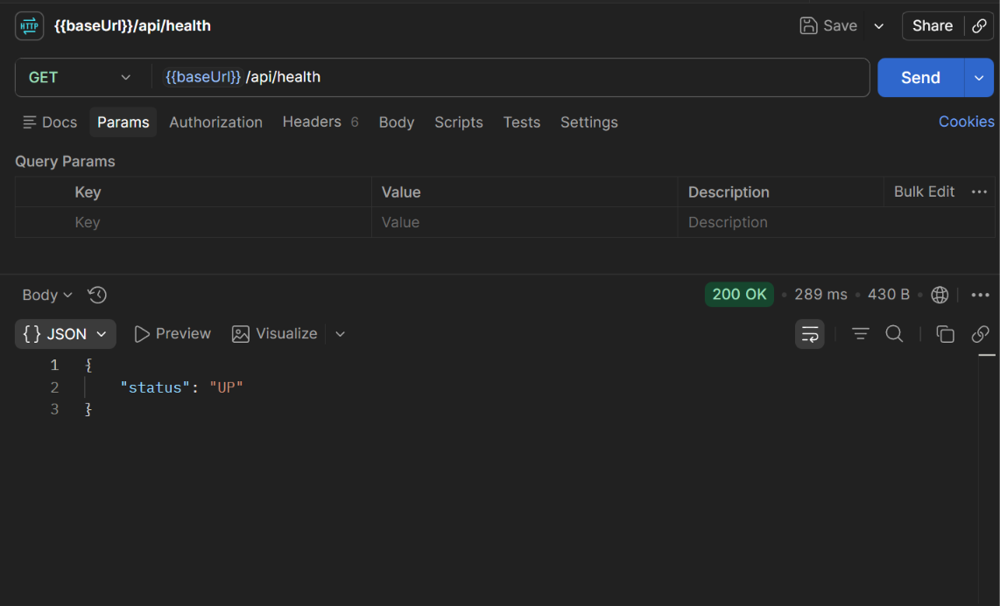
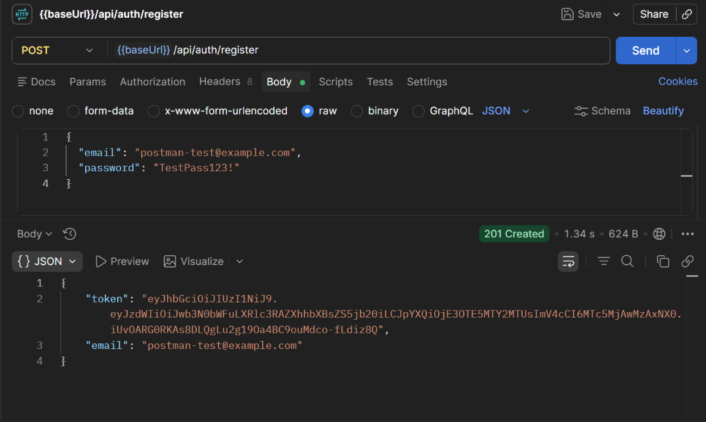
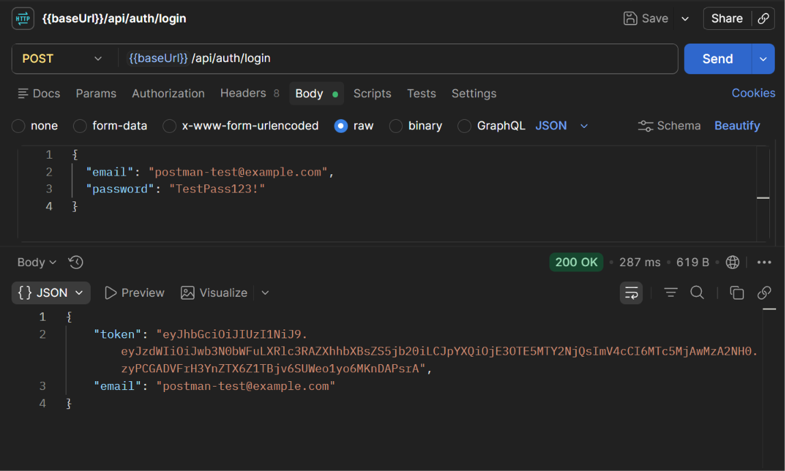
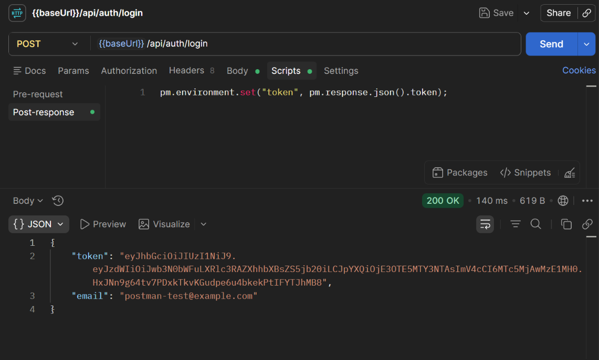
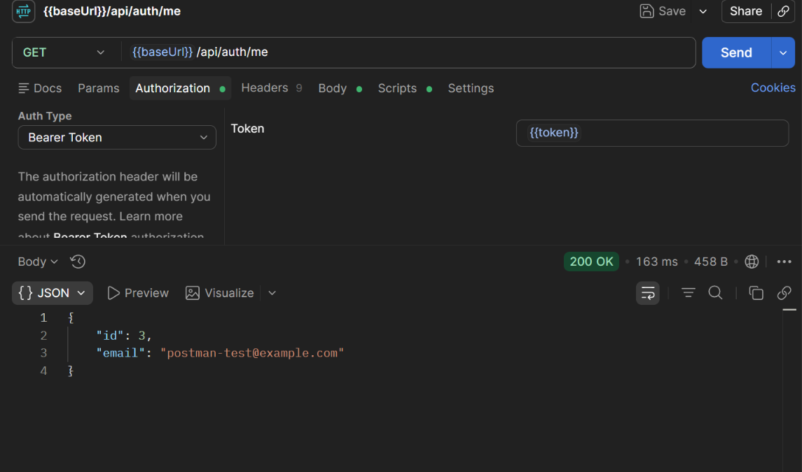

# Zephyra Tech Login Backend

Spring Boot REST API for the Zephyra Tech login application. It provides user registration, login, JWT-based authentication, and a protected current-user endpoint.

## Technology

- Java 21
- Spring Boot 4.1.1 (the selected target, as declared in `pom.xml`)
- Spring Security and JWT (JJWT)
- Spring Data JPA
- PostgreSQL
- Maven Wrapper

## API

All request and response bodies use JSON.

| Method | Endpoint | Access | Purpose |
| --- | --- | --- | --- |
| `POST` | `/api/auth/register` | Public | Register a user and return a JWT |
| `POST` | `/api/auth/login` | Public | Authenticate and return a JWT |
| `GET` | `/api/auth/me` | Bearer JWT | Return the authenticated user's ID and email |
| `GET` | `/api/health` | Public | Return `{"status":"UP"}` |

### Register

Request:

```json
{
  "email": "person@example.com",
  "password": "your-password"
}
```

Successful response (`201 Created`):

```json
{
  "token": "<jwt>",
  "email": "person@example.com"
}
```

Email and password are required; the email must be valid. Registering an email that already exists returns `409 Conflict`.

### Login

Send the same `email` and `password` fields as registration. On success, the response contains a JWT and the email. Invalid credentials return `401 Unauthorized`.

### Current user

Pass the token returned by registration or login in the `Authorization` header:

```http
Authorization: Bearer <jwt>
```

Successful response:

```json
{
  "id": 1,
  "email": "person@example.com"
}
```

The password hash is never included in this response. Missing or invalid authentication returns `401 Unauthorized`.

## Screenshots

The following Postman screenshots demonstrate the API requests and responses. Credentials and JWTs should be redacted in any screenshots shared publicly.

### Health check



### Registration



### Login



### Save login token in Postman



### Protected profile



Never include real passwords, unredacted JWTs, database credentials, signing keys, or personal account details in screenshots.

## Run locally

1. Install Java 21 and PostgreSQL.
2. Create a PostgreSQL database and configure `SPRING_DATASOURCE_URL`, `SPRING_DATASOURCE_USERNAME`, and `SPRING_DATASOURCE_PASSWORD` in your local environment.
3. Generate a new JWT signing key and configure it as `JWT_SECRET`. In PowerShell, generate a 32-byte random key encoded as hex with:

   ```powershell
   [Convert]::ToHexString([System.Security.Cryptography.RandomNumberGenerator]::GetBytes(32))
   ```

   Store the result in your local environment or deployment provider's secret configuration. Do not commit it or use a published key.
4. From the repository root, run:

   ```powershell
   .\mvnw.cmd spring-boot:run
   ```

The application listens on port `8080` by default. The default CORS origin is `http://localhost:3000`. The example configuration requires database environment variables and `JWT_SECRET`; none have credential or signing-key fallbacks.

Run the tests with:

```powershell
.\mvnw.cmd test
```

The test suite uses an in-memory H2 database and does not require a local PostgreSQL server. Authentication integration tests cover public health, registration and login token issuance, access to the protected profile with both issued tokens, email normalization, password/email validation, duplicate registration, invalid credentials and invalid or missing JWTs. The profile response is also checked to ensure it does not expose the password hash.

## Configuration

Spring Boot environment variables can override the corresponding properties:

| Environment variable | Property | Purpose |
| --- | --- | --- |
| `SPRING_DATASOURCE_URL` | `spring.datasource.url` | PostgreSQL JDBC URL |
| `SPRING_DATASOURCE_USERNAME` | `spring.datasource.username` | Database username |
| `SPRING_DATASOURCE_PASSWORD` | `spring.datasource.password` | Database password |
| `JWT_SECRET` | `jwt.secret` | Hex-encoded JWT signing key; use a private, random key of at least 32 bytes |
| `JWT_EXPIRATION` | `jwt.expiration` | Token lifetime in milliseconds; default is 86400000 (24 hours) |
| `CORS_ALLOWED_ORIGINS` | `cors.allowed-origins` | Comma-separated allowed frontend origins |

Keep production credentials and JWT signing keys in the hosting provider's secret/environment configuration. Do not commit them to source control. Use the PostgreSQL connection details supplied by the database host to create a `jdbc:postgresql://...` URL.
The project intentionally targets Spring Boot 4.1.1; keep this aligned with the version in `pom.xml` when upgrading.

If database credentials or a JWT key were included in an archive shared with anyone else, treat them as compromised: rotate the database credentials and replace the JWT key in the deployment environment. Git ignore rules do not exclude files when creating ZIP archives, so exclude local `application.properties`, `.env.local`, dependency folders, and build output before sharing one.

## Render deployment notes

This repository contains the backend only. To deploy it as a Render web service:

1. Publish this repository to a public GitHub repository.
2. Create a PostgreSQL database accessible to the Render web service.
3. Create a Render Web Service connected to this repository and select Java/runtime support appropriate for Java 21.
4. Use the Maven Wrapper to build:

   ```sh
   ./mvnw clean package
   ```

5. Start the packaged application on Render's assigned port:

   ```sh
   java -Dserver.port=${PORT:-8080} -jar target/login-backend-0.0.1-SNAPSHOT.jar
   ```

6. Set the PostgreSQL variables, `JWT_SECRET`, and `JWT_EXPIRATION` in the Render service environment. Set `CORS_ALLOWED_ORIGINS` to the exact deployed frontend origin, for example `https://your-frontend.vercel.app` (no path or trailing slash).
7. After deployment, verify `GET https://<your-render-service>/api/health` returns `{"status":"UP"}` and test registration, login, and the protected current-user endpoint.

The Render service is not deployed by this repository or README; deployment, database provisioning, and verification must be completed in the hosting accounts.