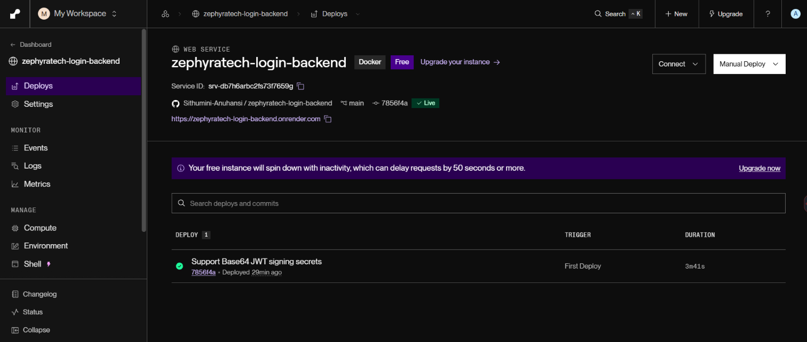
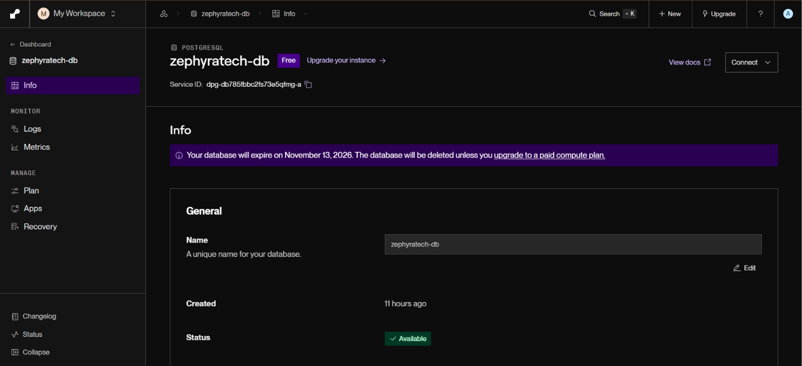
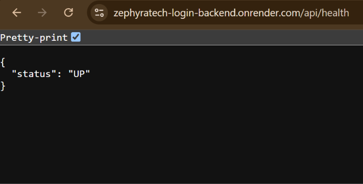

# Zephyra Tech Login — Backend

This repository contains the REST API for Zephyra Tech Login. The Java and Spring Boot service handles account registration, password verification, JWT issuance and validation, protected profile access, and PostgreSQL persistence. The Next.js frontend is maintained in a separate repository.

## Live application

- **Frontend:** [https://zephyratech-login-frontend.vercel.app](https://zephyratech-login-frontend.vercel.app)
- **Frontend source:** [zephyratech-login-frontend](https://github.com/Sithumini-Anuhansi/zephyratech-login-frontend)
- **Backend API:** [https://zephyratech-login-backend.onrender.com](https://zephyratech-login-backend.onrender.com)
- **Backend source:** [zephyratech-login-backend](https://github.com/Sithumini-Anuhansi/zephyratech-login-backend)
- **API health check:** [https://zephyratech-login-backend.onrender.com/api/health](https://zephyratech-login-backend.onrender.com/api/health)

## Demo account

The following disposable demo account is registered in the live application:

- **Email:** `zephyra.demo@example.com`
- **Password:** `Zephyra!Demo-Bluebird`

This account is for demonstration only. Do not use it for personal or sensitive information, and do not reuse its password on another service.

## API

All request and response bodies use JSON.

| Method | Endpoint | Access | Description |
| --- | --- | --- | --- |
| `POST` | `/api/auth/register` | Public | Register an account and return a JWT |
| `POST` | `/api/auth/login` | Public | Authenticate and return a JWT |
| `GET` | `/api/auth/me` | Bearer JWT required | Return the authenticated user's ID and email |
| `GET` | `/api/health` | Public | Return `{"status":"UP"}` |

Registration and login accept an email and password:

```json
{
  "email": "person@example.com",
  "password": "your-password"
}
```

The registration endpoint validates and normalizes the email, enforces the password-length requirement, and rejects duplicate accounts. Passwords are stored as BCrypt hashes. Authentication endpoints return a JWT; the protected profile endpoint requires it in the `Authorization: Bearer <token>` header. The profile response does not include the password hash.

## Screenshots

These Postman screenshots demonstrate the API responses. They use test data; credentials and JWTs should be redacted in any replacement screenshots.

### Health check


### Registration


### Login


### Save login token in Postman


### Protected profile


## Deployment evidence

These screenshots show the live Render web service, the associated PostgreSQL database, and the public health endpoint response.

### Render web service



### Render PostgreSQL database



### Public API health check



## Configuration and security

The deployed service uses environment-based configuration for its database connection, JWT signing key, and allowed frontend origins. The tracked example configuration does not contain credentials or a fallback signing key. Production secrets are configured in the hosting environment and are not included in this repository.

The Vercel frontend origin is allowed by the deployed service's CORS configuration. JWT signing keys and database credentials must remain private; do not include them in screenshots, archives, or source control.

## Technology

- Java 21
- Spring Boot 4.1.1
- Spring Security and JJWT
- Spring Data JPA
- PostgreSQL
- Maven Wrapper

The repository includes an H2-backed automated test suite for authentication and profile behavior.
